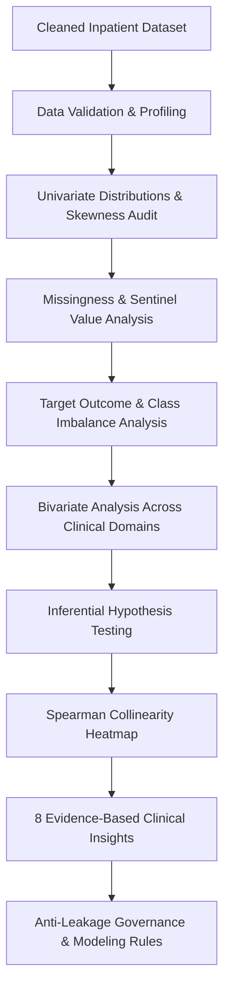
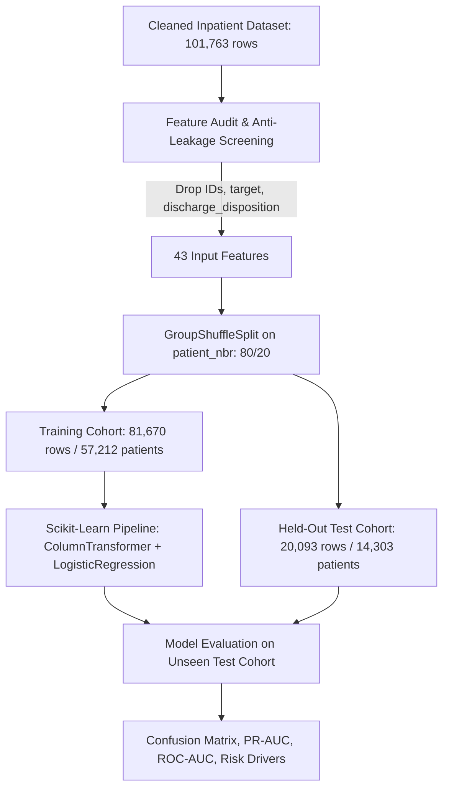

# SWYNEX Technologies — Clinical Data Science Pipeline

[](https://github.com/AbhijeetArunGore/SWYNEX-Data-Preparation/actions)
[](https://www.python.org/)
[](https://opensource.org/licenses/MIT)
[](https://github.com/psf/black)

This repository contains the end-to-end data science work completed during my internship at **SWYNEX Technologies**. The project is structured into modular internship tasks investigating diabetic inpatient encounters across 130 US hospitals (1999–2008) sourced from the **UCI Machine Learning Repository**.

---

## 📌 Project Navigation
- 📓 **Task 1 Notebook**: [`SWYNEX_Data_Preparation.ipynb`](SWYNEX_Data_Preparation.ipynb) — Ingestion, quality auditing, contextual imputation, and relational ID mapping.
- 📓 **Task 2 Notebook**: [`notebooks/02_exploratory_data_analysis.ipynb`](notebooks/02_exploratory_data_analysis.ipynb) — Comprehensive distribution profiling, bivariate risk analysis, hypothesis testing, and anti-leakage governance.
- 📓 **Task 3 Notebook**: [`notebooks/03_modeling_and_evaluation.ipynb`](notebooks/03_modeling_and_evaluation.ipynb) — Leak-free patient-grouped split, balanced logistic regression, confusion matrix audit, and discrimination curves.
- 📄 **Executive Analytical Reports**:
  - Task 2 EDA: [`reports/eda/eda_summary_report.md`](reports/eda/eda_summary_report.md)
  - Task 3 Modeling: [`reports/modeling/model_evaluation_report.md`](reports/modeling/model_evaluation_report.md)
- 📚 **Documentation & Submission**:
  - Clinical Schema: [`docs/DATA_DICTIONARY.md`](docs/DATA_DICTIONARY.md)
  - Task 2 Presentation Guide: [`docs/LINKEDIN_DEMO_TASK2.md`](docs/LINKEDIN_DEMO_TASK2.md)
  - Task 3 Presentation Guide: [`docs/LINKEDIN_DEMO_TASK3.md`](docs/LINKEDIN_DEMO_TASK3.md)
- 📊 **Visual Artifacts**:
  - EDA Figures: [`reports/eda/figures/`](reports/eda/figures/)
  - Modeling Figures: [`reports/modeling/figures/`](reports/modeling/figures/)
- 📈 **Machine-Readable Metrics**: [`reports/modeling/metrics.json`](reports/modeling/metrics.json)

---

## 📂 Repository Structure
```
SWYNEX-Data-Preparation/
├── .github/workflows/
│   └── test.yml                         # Automated CI testing pipeline (pytest)
├── data/
│   ├── raw/
│   │   ├── diabetic_data.csv            # Original UCI clinical dataset (101,766 x 50)
│   │   └── IDS_mapping.csv              # Relational lookup mappings (admission/discharge IDs)
│   └── processed/
│       ├── diabetic_data_clean.csv      # Cleaned baseline dataset (101,763 x 54, 0 nulls)
│       └── diabetic_data_clean.parquet  # High-performance Parquet format
├── docs/
│   ├── DATA_DICTIONARY.md               # Clinical feature definitions & categories
│   ├── LINKEDIN_DEMO_TASK2.md           # Task 2 LinkedIn showcase & demo script
│   └── LINKEDIN_DEMO_TASK3.md           # Task 3 LinkedIn showcase & demo script
├── notebooks/
│   ├── 02_exploratory_data_analysis.ipynb # Task 2 Main Interactive EDA Notebook
│   └── 03_modeling_and_evaluation.ipynb # Task 3 Main Modeling & Evaluation Notebook
├── reports/
│   ├── eda/
│   │   ├── eda_summary_report.md        # Executive Task 2 Analytical Report
│   │   └── figures/                     # Exported 300-DPI EDA visual artifacts
│   └── modeling/
│       ├── model_evaluation_report.md   # Executive Task 3 Modeling & Evaluation Report
│       ├── metrics.json                 # Pinned machine-readable test set metrics
│       └── figures/                     # Exported 300-DPI modeling figures
├── scripts/
│   ├── compute_eda_stats.py             # Empirical statistics calculation script
│   ├── generate_eda_figures.py          # Automated EDA figure generation script
│   ├── generate_modeling_artifacts.py   # Automated modeling training & artifact script
│   └── validate_dataset.py              # Task 1 dataset integrity validator
├── src/
│   ├── __init__.py                      # Package initialization
│   ├── utils.py                         # Task 1 data preparation functions
│   ├── eda.py                           # Task 2 modular EDA & statistical testing utilities
│   └── modeling.py                      # Task 3 modular modeling pipeline & evaluation functions
├── tests/
│   ├── test_preprocessing.py            # Task 1 unit tests
│   ├── test_eda.py                      # Task 2 EDA functions unit test suite
│   └── test_modeling.py                 # Task 3 modeling pipeline & metrics unit tests
├── SWYNEX_Data_Preparation.ipynb        # Task 1 Main Data Preparation Notebook
├── requirements.txt                     # Pinned project dependencies
└── README.md                            # Comprehensive project documentation
```

---

## 🔬 Dataset Overview
- **Dataset**: Diabetes 130-US Hospitals for Years 1999–2008
- **Source**: UCI Machine Learning Repository
- **Scope**: 101,763 cleaned inpatient admissions across 71,515 unique patients and 130 hospital facilities.
- **Analytical Role**: Historical observational cohort of adult diabetic patients with inpatient stays between 1 and 14 days.

---

# 🛠️ Task 1: Data Preparation

### Objective & Accomplishments
Task 1 addressed extensive data quality challenges inherent to real-world healthcare administration:
- **Implicit Missingness**: Replaced `'?'` and invalid strings with standardized `NaN` values.
- **Extreme Missingness Pruning**: Excluded `weight` (>96.8% missing) to avoid introducing extreme artificial variance.
- **Informative Missingness Retention**: Retained administrative missingness in `payer_code` (39.56%) and `medical_specialty` (49.08%) as explicit `'Missing'` categories.
- **Zero-Variance Removal**: Dropped constant features (`examide`, `citoglipton`).
- **ICD-9 Categorization**: Condensed 900+ distinct diagnostic codes into 9 standard clinical categories (Circulatory, Respiratory, Digestive, Diabetes, Injury, Musculoskeletal, Genitourinary, Neoplasms, Other).
- **Relational ID Mapping**: Parsed `IDS_mapping.csv` to map numerical integer codes into readable clinical text labels.
- **Export**: Standardized output to `data/processed/diabetic_data_clean.csv` (101,763 rows, 54 columns, 0 nulls).

---

# 📊 Task 2: Exploratory Data Analysis (EDA)

### Objective
Task 2 delivers an evidence-based exploratory evaluation of the prepared cohort to uncover patient sub-populations, test clinical hypotheses, evaluate severe class imbalance, and formulate strict data-leakage prevention guardrails for downstream machine learning.

> **Note on Modeling Scope**: Task 2 is strictly descriptive and exploratory. It does not perform predictive model training or hyperparameter tuning.



### Key Analytical Findings & Verified Insights

| # | Investigated Domain | Computed Empirical Evidence | Key Clinical & Modeling Finding |
|---|---|---|---|
| **1** | **Prior Inpatient Utilization** | Rate rises from **8.44%** (0 visits) to **12.92%** (1 visit), **20.29%** (3 visits), and **34.58%** (6 visits) ($U=401,064,764, p < 10^{-15}$). | Prior acute hospitalizations serve as the dominant leading indicator of 30-day early readmission. |
| **2** | **Target Class Imbalance** | 30-day readmissions (`<30`) comprise only **11.16%** of encounters (11,357 of 101,763). | ~8:1 class imbalance invalidates raw accuracy (trivial null model achieves 88.84% accuracy). PR-AUC and cost-sensitive loss are mandatory. |
| **3** | **Post-Acute Care Transfers** | Rehabilitation discharges had **27.71%** 30-day readmission; Skilled Nursing Facilities (SNF) had **14.66%**, vs **9.30%** for home discharges. | Transitional sub-acute destinations flag severe medical frailty and transitional care vulnerability. |
| **4** | **Terminal Event Leakage** | 1,642 encounters resulted in inpatient death (`Expired`), all showing **0.00%** readmission. | **Mandatory Filtering Rule**: All expired encounters must be removed prior to model training to prevent target leakage. |
| **5** | **Length of Stay & Medications** | Length of stay correlates moderately with medications ($\rho = 0.465, p < 10^{-15}$), but median stay differs by only 1 day (<30: 4.0 vs NO: 3.0 days). | Hospital duration reflects inpatient care intensity but cannot serve as a standalone risk predictor. |
| **6** | **Glycemic Testing Adherence** | 84,745 encounters (**83.28%**) had no documented HbA1c test (`Not Tested`), showing **11.42%** readmissions vs **9.66%** for normal tested patients. | Omission of glycemic testing was pervasive in 1999–2008 and acts as a proxy for structured clinical care adherence. |
| **7** | **Medication Titration** | Dosage adjustments (`change` = Ch) had **12.24%** readmissions vs **10.23%** for stable regimens ($\chi^2 = 215.94, p = 1.289 \times 10^{-47}$). | In-hospital medication titration flags acute unstable blood glucose requiring post-discharge outpatient stabilization. |
| **8** | **Intra-Patient Clustering** | 101,763 encounters belong to 71,515 distinct patients (**29.72% repeat admissions**, up to 40 per patient). | Standard random train/test splits cause severe data leakage. Future validation must enforce **GroupKFold** on `patient_nbr`. |

---

## 🧪 Inferential Statistical Testing Summary

| Test Applied | Null Hypothesis ($H_0$) | Test Statistic | p-Value | Practical Interpretation |
| :--- | :--- | :---: | :---: | :--- |
| **Mann-Whitney U** | Inpatient visits distribution is identical between `<30` and `NO` groups. | $U = 401,064,764$ | $< 10^{-15}$ | **Reject $H_0$**: Readmitted patients averaged 1.224 prior admissions vs 0.382 for non-readmitted patients (>3.2x higher). |
| **Mann-Whitney U** | Length of stay distribution is identical between `<30` and `NO` groups. | $U = 347,113,746$ | $1.595 \times 10^{-83}$ | **Reject $H_0$**: Readmitted cohort stays are significantly longer (median = 4.0 vs 3.0 days). |
| **Pearson Chi-Square** | Readmission outcome is independent of diabetes medication change (`change`). | $\chi^2 = 215.94$ | $1.289 \times 10^{-47}$ | **Reject $H_0$**: Significant dependency (Cramer's $V = 0.0461$); regimen changes correlate with elevated readmissions. |
| **Pearson Chi-Square** | Readmission outcome is independent of age bracket (`age`). | $\chi^2 = 313.33$ | $8.676 \times 10^{-56}$ | **Reject $H_0$**: Elderly cohorts (70–90 years) exhibit significantly elevated readmission rates. |

---

## 🛡️ Anti-Leakage Governance & Modeling Guardrails

Before proceeding to Task 3 (Predictive Modeling), the following data governance requirements are established:
1. **Exclude Expired Patients**: Remove 1,642 encounters where `discharge_disposition_id` $\in \{11, 19, 20, 21\}$.
2. **Enforce Grouped Cross-Validation**: Split data strictly by `patient_nbr` using `GroupKFold` or `GroupShuffleSplit` to prevent patient records from leaking across folds.
3. **Segregate Feature Timing**: Distinguish admission-time variables (demographics, prior visits) from pre-discharge variables (total stay, discharge destination).
4. **Target Metric Selection**: Optimize models for **PR-AUC** and recall at calibrated risk cutoffs rather than raw accuracy.

---

# 🤖 Task 3: Modeling and Evaluation

### Objective & Problem Formulation
Task 3 establishes an interpretable, reproducible machine learning baseline to predict **30-day early hospital readmission** for diabetic inpatients:
- **Binary Target Formulation**:
  - **Positive Class (`1`)**: `readmitted == '<30'` (11,357 encounters, **11.16%** base rate).
  - **Negative Class (`0`)**: `readmitted` $\in$ `{NO, >30}` (90,406 encounters, **88.84%**).
- **Clinical Meaning**: Predicts whether an encounter is followed by a recorded readmission within 30 days of discharge. `NO` indicates no recorded readmission within the monitored hospital system, not proof that the patient was never readmitted.



### Strict Anti-Leakage Implementation
1. **Patient-Grouped Holdout Split**: Encounters are partitioned strictly by `patient_nbr` using `GroupShuffleSplit(n_splits=1, test_size=0.20, random_state=42)`:
   - **Training Set**: 81,670 encounters across 57,212 unique patients.
   - **Held-Out Test Set**: 20,093 encounters across 14,303 unique patients.
   - **Zero Patient Overlap**: Exactly 0 patients overlap between train and test sets, preventing optimistic data leakage from recurring patients.
2. **Leakage Feature Pruning**: Deliberately excluded post-discharge terminal event variables (`discharge_disposition_id` / `discharge_disposition_desc` containing `Expired`), ensuring the model uses only information available during the hospital encounter.
3. **Identifiers Excluded**: `encounter_id` and `patient_nbr` are excluded from model inputs.

### Preprocessing & Architecture
- **Pipeline Encapsulation**: Fitted exclusively on training data using `ColumnTransformer`:
  - **9 Numerical Features**: Standardized with `StandardScaler` (median-imputed).
  - **34 Categorical Features**: One-hot encoded with `OneHotEncoder(handle_unknown='ignore')`.
- **Baseline Benchmark**: `DummyClassifier(strategy='most_frequent')`.
- **Primary Model**: `LogisticRegression(max_iter=1000, class_weight='balanced', random_state=42)`.

### Empirical Test Set Results (Held-Out Test Cohort: N = 20,093)

| Model Architecture | Accuracy | Precision | Recall (Sensitivity) | F1-Score | ROC-AUC | PR-AUC (Average Precision) |
| :--- | :---: | :---: | :---: | :---: | :---: | :---: |
| **DummyClassifier** (Majority Class) | **89.08%** | 0.00% | 0.00% | 0.0000 | 0.5000 | 0.1092 |
| **Balanced Logistic Regression** | **65.86%** | **16.48%** | **52.26%** | **0.2506** | **0.6435** | **0.1887** |

> **Key Analytical Takeaway**: While the dummy classifier demonstrates deceptively high accuracy (89.08%), it fails to detect a single readmitted patient (Recall = 0.0%). Balanced Logistic Regression successfully identifies **52.26% of all true readmissions** (1,147 patients) and achieves a **+72.8% relative gain in PR-AUC** (0.1887 vs 0.1092 baseline).

### Confusion Matrix Breakdown (Held-Out Test Cohort)

| Metric | Count | Clinical & Operational Interpretation |
| :--- | :---: | :--- |
| **True Negatives (TN)** | **12,086** | Patients correctly identified as low risk; avoiding unnecessary follow-up costs. |
| **False Positives (FP)** | **5,812** | False alarms; patients receive low-cost transitional check-ins (e.g., pharmacist phone calls). |
| **False Negatives (FN)** | **1,048** | Readmissions missed by the linear baseline. |
| **True Positives (TP)** | **1,147** | High-risk patients successfully flagged for discharge planning interventions. |

- **Precision vs. Recall Trade-Off**: With ~10.9% test prevalence, `class_weight='balanced'` prioritizes sensitivity over precision. In hospital operations, a false alarm triggers a harmless, low-cost outreach, whereas a False Negative may leave a deteriorating patient unmonitored at home.

### Top Risk Drivers (Standardized Log-Odds Coefficients)
- **`number_inpatient` ($\beta = +0.3517$)**: The strongest positive predictor. Prior hospitalizations significantly elevate readmission risk.
- **`number_diagnoses` ($\beta = +0.0933$) & `age_midpoint` ($\beta = +0.0777$)**: Reflect chronic multi-morbidity and geriatric frailty.
- **Specialty Flags**: Inpatient encounters managed by `Allergy and Immunology` (+1.03) and `Hematology` (+0.98) show elevated readmission risk, reflecting complex immune and oncological disorders.

---

## 💻 Installation & Reproduction Guide

### Environment Setup
```bash
# Clone the repository
git clone https://github.com/AbhijeetArunGore/SWYNEX-Data-Preparation.git
cd SWYNEX-Data-Preparation

# Install requirements
pip install -r requirements.txt
```

### Run Complete Unit Test Suite
```bash
# Run all 17 unit tests across Task 1, Task 2, and Task 3
python -m pytest tests/
```

### Generate Visual & Metric Artifacts
```bash
# Generate EDA figures into reports/eda/figures/
python scripts/generate_eda_figures.py

# Generate modeling figures and metrics.json into reports/modeling/
python scripts/generate_modeling_artifacts.py
```

### Execute Interactive Notebooks
```bash
# Task 1: Data Preparation
jupyter notebook SWYNEX_Data_Preparation.ipynb

# Task 2: Exploratory Data Analysis
jupyter notebook notebooks/02_exploratory_data_analysis.ipynb

# Task 3: Modeling and Evaluation
jupyter notebook notebooks/03_modeling_and_evaluation.ipynb
```

---

## ⚠️ Limitations & Clinical Disclaimer
- **Educational Baseline**: This model is built as an educational demonstration of machine learning evaluation under class imbalance. It is **not a clinically validated diagnostic tool** and should not be used for direct patient triage or hospital policy decisions.
- **Historical Observational Data**: Collected from 1999–2008 across 130 US hospitals; does not reflect modern diabetes pharmaceuticals (e.g. GLP-1 agonists, SGLT2 inhibitors).
- **No Causal Inference**: Associations reflect empirical patterns and cannot be interpreted as direct causal mechanisms.
- **Billing Code Proxies**: Diagnoses rely on ICD-9 administrative codes subject to billing incentives.

---

## 👤 Author
**Abhijeet Arun Gore**  
Data Science Intern, SWYNEX Technologies  
GitHub: [@AbhijeetArunGore](https://github.com/AbhijeetArunGore)  
LinkedIn: [Abhijeet Arun Gore](https://www.linkedin.com/in/abhijeet-gore-04a60124b/)

---

## 📜 License
This repository is licensed under the MIT License. See [LICENSE](LICENSE) for details.
