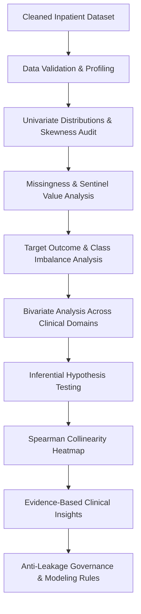

# SWYNEX Technologies — Clinical Data Science Capstone
## End-to-End Healthcare Readmission Analysis: Predicting 30-Day Hospital Readmissions in Inpatient Diabetic Encounters

[](https://github.com/AbhijeetArunGore/SWYNEX-Data-Science-Internship/actions)
[](https://www.python.org/)
[](https://opensource.org/licenses/MIT)
[](https://github.com/psf/black)
[](tests/)

This repository presents the capstone data science investigation completed during my internship at **SWYNEX Technologies**. The project investigates **101,763 diabetic inpatient hospital encounters** across 130 US hospitals (1999–2008) sourced from the **UCI Machine Learning Repository**. The project connects data preparation, exploratory data analysis, anti-leakage governance, and predictive modeling into an end-to-end clinical case study.

---

## 📖 Executive Project Overview (For Non-Technical & Technical Readers)

### The Problem
*Can historical hospital encounter data help identify inpatient encounters associated with an early readmission within 30 days of discharge, and what are the limitations of making that prediction?*

### Why It Matters
Hospital readmissions within 30 days represent a major challenge for modern healthcare systems. Under the **Hospital Readmissions Reduction Program (HRRP)**, hospitals face financial penalties for elevated readmission rates. For diabetic patients, early readmission frequently signals acute transitional care breakdown, post-discharge glycemic volatility, or gaps in patient self-management. Identifying high-risk encounters prior to discharge allows clinical teams to deploy targeted, low-cost preventive interventions (such as pharmacist medication reconciliation or nurse follow-up phone calls).

### The Data Analyzed
- **Source**: UCI Diabetes 130-US Hospitals dataset (1999–2008).
- **Scope**: 101,763 cleaned inpatient admissions across **71,515 unique patients** and **130 hospital facilities**.
- **Unit of Observation**: Each record represents a single inpatient hospitalization stay (lasting between 1 and 14 days).
- **Target Outcome**: Binary early readmission:
  - **Positive Class (`1`)**: Readmitted within 30 days (`<30`), comprising **11,357 encounters (11.16%)**.
  - **Negative Class (`0`)**: No recorded readmission within 30 days (`NO` or `>30`), comprising **90,406 encounters (88.84%)**.

### The Approach
1. **Task 1 (Data Preparation)**: Converted EHR sentinel missing values (`'?'`), pruned uninformative extreme-missing features (`weight` >96%), retained informative administrative missingness (`payer_code`, `medical_specialty`), collapsed 900+ raw ICD-9 codes into 9 clinical categories, and resolved relational lookups into clean text labels.
2. **Task 2 (Exploratory Data Analysis)**: Evaluated class imbalance (~8:1), tested clinical hypotheses (Mann-Whitney U, Pearson Chi-Square), analyzed medication titration patterns, and established anti-leakage rules.
3. **Task 3 (Modeling & Evaluation)**: Implemented strict patient-level grouped validation (`GroupShuffleSplit` on `patient_nbr` ensuring **0 patient overlap**), pruned terminal discharge leakage, and benchmarked a majority-class `DummyClassifier` against a balanced `LogisticRegression` pipeline.
4. **Task 4 (Final Case Study)**: Synthesized all stages into an integrated, reproducible capstone case study with dual-audience documentation, trade-off audits, and transparent limitations.

### Key Empirical Findings
1. **Prior Hospital Admissions are the Dominant Risk Signal**: Readmission risk rises monotonically from **8.44%** for patients with 0 prior inpatient stays to **12.92%** at 1 visit, **20.29%** at 3 visits, and **34.58%** at 6+ visits (Mann-Whitney $U = 401,064,764, p < 10^{-15}$). In multivariable regression, `number_inpatient` had the highest positive coefficient ($\beta = +0.3517$).
2. **The "Accuracy Trap" in Imbalanced Healthcare Data**: An ~8:1 negative-to-positive ratio means a naive model that blindly predicts "no readmission" for everyone achieves **89.08% accuracy**, yet fails to detect a single readmitted patient (Recall = 0.0%).
3. **Medication Titration Reflects Glycemic Instability**: In-hospital diabetes drug adjustments (`change` = Ch) were associated with a **12.24%** readmission rate compared to **10.23%** for stable regimens ($\chi^2 = 215.94, p = 1.289 \times 10^{-47}$).
4. **Post-Acute Care Vulnerability & Terminal Leakage**: Patients discharged to rehabilitation centers had a **27.71%** 30-day readmission rate. Conversely, 1,642 deceased patients (`Expired`) showed an exact **0.00%** readmission rate, proving that terminal discharge status must be excluded to prevent artificial target leakage.
5. **Multi-Morbidity Compounds Risk**: Diagnosis count (`number_diagnoses`, $\beta = +0.0933$) and age (`age_midpoint`, $\beta = +0.0777$) jointly elevate readmission risk.

### Model Performance on Unseen Test Data (N = 20,093 Encounters, 14,303 Patients)

| Model Architecture | Accuracy | Precision | Recall (Sensitivity) | F1-Score | ROC-AUC | PR-AUC (Average Precision) |
| :--- | :---: | :---: | :---: | :---: | :---: | :---: |
| **DummyClassifier** (Majority Class) | **89.08%** | 0.00% | 0.00% | 0.0000 | 0.5000 | 0.1092 |
| **Balanced Logistic Regression** | **65.86%** | **16.48%** | **52.26%** | **0.2506** | **0.6435** | **0.1887** |

> **Key Performance Takeaway**:  
> **The model identified 1,147 of the 2,195 early-readmission encounters in the test set, but it also incorrectly flagged 5,812 encounters as high risk.**

### What the Results Mean (Operational Trade-Off)
Because early readmissions are relatively uncommon (10.92% test base rate), our model uses `class_weight='balanced'` to prioritize sensitivity over precision. 
- **1,147 True Positives**: Over half (52.26%) of all patients who will be readmitted within 30 days are successfully caught.
- **5,812 False Positives (False Alarms)**: When the model flags a patient as high risk, approximately **1 in 6** is actually readmitted (16.48% precision).
- **Operational Feasibility**: In clinical operations, a false alarm triggers a low-cost, harmless intervention (e.g. a 5-minute phone call from a transitional care nurse or pharmacist medication review). In contrast, missing a deteriorating patient (False Negative) can lead to emergency hospitalization. Thus, accepting false alarms to recover 1,147 vulnerable patients is an operationally sensible trade-off.

### Transparent Limitations
- **Educational Baseline**: This model is an educational demonstration. It is **not a clinically approved decision-support device** and must not be used for bedside triage or clinical decision-making.
- **Historical Observational Data**: Collected from 1999–2008 across 130 US hospitals; does not reflect modern diabetes pharmaceuticals (e.g. GLP-1 receptor agonists, SGLT2 inhibitors) or continuous glucose monitors.
- **Correlation vs. Causation**: Regression coefficients represent empirical associations in observational EHR data, not causal medical mechanisms.
- **Unrecorded Readmissions**: The target variable reflects readmissions within participating hospitals. Readmissions to independent, external facilities were classified as `NO`.

---

## 📌 Project Navigation

- 📓 **Interactive Notebooks**:
  - **Task 1 Notebook**: [`notebooks/01_data_preparation.ipynb`](notebooks/01_data_preparation.ipynb) ([`SWYNEX_Data_Preparation.ipynb`](SWYNEX_Data_Preparation.ipynb)) — Ingestion, auditing, imputation, and ICD-9 mapping.
  - **Task 2 Notebook**: [`notebooks/02_exploratory_data_analysis.ipynb`](notebooks/02_exploratory_data_analysis.ipynb) — Distribution profiling, bivariate risk analysis, hypothesis testing, and leakage governance.
  - **Task 3 Notebook**: [`notebooks/03_modeling_and_evaluation.ipynb`](notebooks/03_modeling_and_evaluation.ipynb) — Patient-grouped holdout, balanced logistic regression, confusion matrix audit, and discrimination curves.
  - **Task 4 Final Case Study**: [`notebooks/04_final_data_science_case_study.ipynb`](notebooks/04_final_data_science_case_study.ipynb) — Complete integrated capstone case study connecting Stages A through H.
- 📄 **Executive Analytical Reports**:
  - **Final Capstone Case Study Report**: [`reports/final_case_study_report.md`](reports/final_case_study_report.md) — Comprehensive end-to-end synthesis.
  - **Task 2 EDA Summary Report**: [`reports/eda/eda_summary_report.md`](reports/eda/eda_summary_report.md) — Clinical EDA findings and statistical tests.
  - **Task 3 Model Evaluation Report**: [`reports/modeling/model_evaluation_report.md`](reports/modeling/model_evaluation_report.md) — Baseline comparison and coefficient audit.
- 📚 **Clinical Schema Documentation**: [`docs/DATA_DICTIONARY.md`](docs/DATA_DICTIONARY.md) — 54-feature clinical schema documentation.
- 📊 **Visual Artifacts**:
  - Final Case Study Figures: [`reports/figures/`](reports/figures/)
  - EDA Diagnostic Figures: [`reports/eda/figures/`](reports/eda/figures/)
  - Modeling Diagnostic Figures: [`reports/modeling/figures/`](reports/modeling/figures/)
- 📈 **Machine-Readable Metrics**: [`reports/modeling/metrics.json`](reports/modeling/metrics.json)

---

## 📂 Repository Structure

```
SWYNEX-Data-Science-Internship/
├── .github/workflows/
│   └── test.yml                         # Automated CI testing pipeline (pytest)
├── data/
│   ├── raw/
│   │   ├── diabetic_data.csv            # Original UCI clinical dataset (101,766 x 50)
│   │   └── IDS_mapping.csv              # Relational lookup mappings (admission/discharge IDs)
│   └── processed/
│       ├── diabetic_data_clean.csv      # Cleaned baseline dataset (101,763 x 54, 0 nulls)
│       └── diabetic_data_clean.parquet  # High-performance Parquet format
├── docs/
│   └── DATA_DICTIONARY.md               # Clinical feature definitions & categories
├── notebooks/
│   ├── 01_data_preparation.ipynb        # Task 1 Data Preparation Notebook
│   ├── 02_exploratory_data_analysis.ipynb # Task 2 Main Interactive EDA Notebook
│   ├── 03_modeling_and_evaluation.ipynb # Task 3 Main Modeling & Evaluation Notebook
│   └── 04_final_data_science_case_study.ipynb # Task 4 Master End-to-End Case Study
├── reports/
│   ├── final_case_study_report.md       # Task 4 Capstone Executive Analytical Report
│   ├── figures/                         # Capstone 300-DPI visual artifacts
│   │   ├── 01_eda_clinical_risk_drivers.png
│   │   ├── 02_model_evaluation_diagnostics.png
│   │   └── 03_top_feature_coefficients.png
│   ├── eda/
│   │   ├── eda_summary_report.md        # Task 2 Analytical Report
│   │   └── figures/                     # Task 2 300-DPI figures
│   └── modeling/
│       ├── model_evaluation_report.md   # Task 3 Evaluation Report
│       ├── metrics.json                 # Pinned test set performance metrics
│       └── figures/                     # Task 3 300-DPI figures
├── scripts/
│   ├── compute_eda_stats.py             # Empirical statistics calculation script
│   ├── generate_eda_figures.py          # Automated EDA figure generation script
│   ├── generate_modeling_artifacts.py   # Automated modeling training & artifact script
│   └── validate_dataset.py              # Task 1 dataset integrity validator
├── src/
│   ├── __init__.py                      # Package initialization
│   ├── utils.py                         # Task 1 data preparation functions
│   ├── eda.py                           # Task 2 modular EDA & statistical testing utilities
│   └── modeling.py                      # Task 3 modular modeling pipeline & evaluation functions
├── tests/
│   ├── test_preprocessing.py            # Task 1 unit tests
│   ├── test_eda.py                      # Task 2 EDA functions unit test suite
│   └── test_modeling.py                 # Task 3 modeling pipeline & metrics unit tests
├── SWYNEX_Data_Preparation.ipynb        # Task 1 Main Data Preparation Notebook (Root)
├── requirements.txt                     # Pinned project dependencies
└── README.md                            # Comprehensive project documentation
```

---

## 🔬 Dataset Overview
- **Dataset**: Diabetes 130-US Hospitals for Years 1999–2008
- **Source**: UCI Machine Learning Repository
- **Scope**: 101,763 cleaned inpatient admissions across 71,515 unique patients and 130 hospital facilities.
- **Analytical Role**: Historical observational cohort of adult diabetic patients with inpatient stays between 1 and 14 days.

---

# 🛠️ Task 1: Data Preparation

### Objective & Accomplishments
Task 1 addressed extensive data quality challenges inherent to real-world healthcare administration:
- **Implicit Missingness**: Replaced `'?'` and invalid strings with standardized `NaN` values.
- **Extreme Missingness Pruning**: Excluded `weight` (>96.8% missing) to avoid introducing extreme artificial variance.
- **Informative Missingness Retention**: Retained administrative missingness in `payer_code` (39.56%) and `medical_specialty` (49.08%) as explicit `'Missing'` categories.
- **Zero-Variance Removal**: Dropped constant features (`examide`, `citoglipton`).
- **ICD-9 Categorization**: Condensed 900+ distinct diagnostic codes into 9 standard clinical categories (Circulatory, Respiratory, Digestive, Diabetes, Injury, Musculoskeletal, Genitourinary, Neoplasms, Other).
- **Relational ID Mapping**: Parsed `IDS_mapping.csv` to map numerical integer codes into readable clinical text labels.
- **Export**: Standardized output to `data/processed/diabetic_data_clean.csv` (101,763 rows, 54 columns, 0 nulls).

---

# 📊 Task 2: Exploratory Data Analysis (EDA)

### Objective
Task 2 delivers an evidence-based exploratory evaluation of the prepared cohort to uncover patient sub-populations, test clinical hypotheses, evaluate severe class imbalance, and formulate strict data-leakage prevention guardrails for downstream machine learning.



### Key Analytical Findings & Inferential Tests

| Test Applied | Null Hypothesis ($H_0$) | Test Statistic | p-Value | Practical Interpretation |
| :--- | :--- | :---: | :---: | :--- |
| **Mann-Whitney U** | Inpatient visits distribution is identical between `<30` and `NO` groups. | $U = 401,064,764$ | $< 10^{-15}$ | **Reject $H_0$**: Readmitted patients averaged 1.224 prior admissions vs 0.382 for non-readmitted patients (>3.2x higher). |
| **Mann-Whitney U** | Length of stay distribution is identical between `<30` and `NO` groups. | $U = 347,113,746$ | $1.595 \times 10^{-83}$ | **Reject $H_0$**: Readmitted cohort stays are significantly longer (median = 4.0 vs 3.0 days). |
| **Pearson Chi-Square** | Readmission outcome is independent of diabetes medication change (`change`). | $\chi^2 = 215.94$ | $1.289 \times 10^{-47}$ | **Reject $H_0$**: Significant dependency (Cramer's $V = 0.0461$); regimen changes correlate with elevated readmissions. |
| **Pearson Chi-Square** | Readmission outcome is independent of age bracket (`age`). | $\chi^2 = 313.33$ | $8.676 \times 10^{-56}$ | **Reject $H_0$**: Elderly cohorts (70–90 years) exhibit significantly elevated readmission rates. |

---

# 🤖 Task 3 & 4: Modeling, Evaluation & Final Case Study

### Strict Anti-Leakage Implementation
1. **Patient-Grouped Holdout Split**: Encounters are partitioned strictly by `patient_nbr` using `GroupShuffleSplit(n_splits=1, test_size=0.20, random_state=42)`:
   - **Training Set**: 81,670 encounters across 57,212 unique patients.
   - **Held-Out Test Set**: 20,093 encounters across 14,303 unique patients.
   - **Zero Patient Overlap**: Exactly 0 patients overlap between train and test sets, preventing optimistic data leakage from recurring patients.
2. **Leakage Feature Pruning**: Deliberately excluded post-discharge terminal event variables (`discharge_disposition_id` / `discharge_disposition_desc` containing `Expired`), ensuring the model uses only information available during the hospital encounter.
3. **Identifiers Excluded**: `encounter_id` and `patient_nbr` are excluded from model inputs.

### Preprocessing & Architecture
- **Pipeline Encapsulation**: Fitted exclusively on training data using `ColumnTransformer`:
  - **9 Numerical Features**: Standardized with `StandardScaler` (median-imputed).
  - **34 Categorical Features**: One-hot encoded with `OneHotEncoder(handle_unknown='ignore')`.
- **Baseline Benchmark**: `DummyClassifier(strategy='most_frequent')`.
- **Primary Model**: `LogisticRegression(max_iter=1000, class_weight='balanced', random_state=42)`.

### Detailed Confusion Matrix Breakdown (Held-Out Test Cohort: N = 20,093)

| Metric | Count | Clinical & Operational Interpretation |
| :--- | :---: | :--- |
| **True Negatives (TN)** | **12,086** | Patients correctly identified as low risk; avoiding unnecessary follow-up costs. |
| **False Positives (FP)** | **5,812** | False alarms; patients receive low-cost transitional check-ins (e.g., pharmacist phone calls). |
| **False Negatives (FN)** | **1,048** | Readmissions missed by the linear baseline. |
| **True Positives (TP)** | **1,147** | High-risk patients successfully flagged for discharge planning interventions. |

### Top Risk Drivers (Standardized Log-Odds Coefficients)
- **`number_inpatient` ($\beta = +0.3517$)**: The strongest positive predictor. Prior hospitalizations significantly elevate readmission risk.
- **`number_diagnoses` ($\beta = +0.0933$) & `age_midpoint` ($\beta = +0.0777$)**: Reflect chronic multi-morbidity and geriatric frailty.
- **Specialty Flags**: Inpatient encounters managed by `Allergy and Immunology` (+1.03) and `Hematology` (+0.98) show elevated readmission risk, reflecting complex immune and oncological disorders.

---

## 💻 Installation & Reproduction Guide

### Environment Setup
```bash
# Clone the repository
git clone https://github.com/AbhijeetArunGore/SWYNEX-Data-Science-Internship.git
cd SWYNEX-Data-Science-Internship

# Install requirements
pip install -r requirements.txt
```

### Run Complete Unit Test Suite
```bash
# Run all 17 unit tests across Tasks 1, 2, and 3
python -m pytest tests/ -v
```

### Generate Visual & Metric Artifacts
```bash
# Generate EDA figures into reports/eda/figures/
python scripts/generate_eda_figures.py

# Generate modeling figures and metrics.json into reports/modeling/
python scripts/generate_modeling_artifacts.py
```

### Execute Interactive Notebooks
```bash
# Task 1: Data Preparation
jupyter notebook notebooks/01_data_preparation.ipynb

# Task 2: Exploratory Data Analysis
jupyter notebook notebooks/02_exploratory_data_analysis.ipynb

# Task 3: Modeling and Evaluation
jupyter notebook notebooks/03_modeling_and_evaluation.ipynb

# Task 4: Capstone Integrated Case Study
jupyter notebook notebooks/04_final_data_science_case_study.ipynb
```

---

## ⚠️ Limitations & Clinical Disclaimer
- **Educational Baseline**: This model is built as an educational demonstration of machine learning evaluation under class imbalance. It is **not a clinically validated diagnostic tool** and should not be used for direct patient triage or hospital policy decisions.
- **Historical Observational Data**: Collected from 1999–2008 across 130 US hospitals; does not reflect modern diabetes pharmaceuticals (e.g. GLP-1 agonists, SGLT2 inhibitors).
- **No Causal Inference**: Associations reflect empirical patterns and cannot be interpreted as direct causal mechanisms.
- **Billing Code Proxies**: Diagnoses rely on ICD-9 administrative codes subject to billing incentives.

---

## 👤 Author
**Abhijeet Arun Gore**  
Data Science Intern, SWYNEX Technologies  
GitHub: [@AbhijeetArunGore](https://github.com/AbhijeetArunGore)  
LinkedIn: [Abhijeet Arun Gore](https://www.linkedin.com/in/abhijeet-gore-04a60124b/)

---

## 📜 License
This repository is licensed under the MIT License. See [LICENSE](LICENSE) for details.
