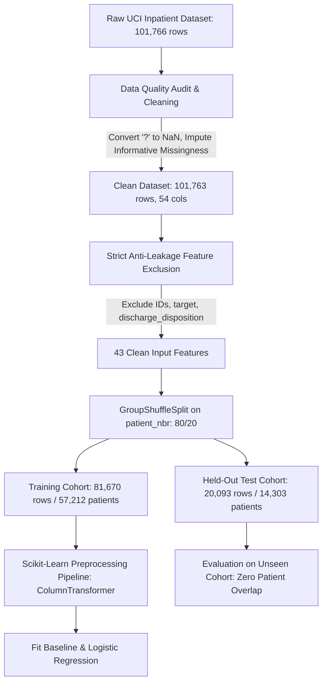

# SWYNEX Technologies — Final Data Science Case Study Report
## End-to-End Healthcare Readmission Analysis: Predicting 30-Day Hospital Readmissions in Inpatient Diabetic Encounters

**Author**: Abhijeet Arun Gore  
**Role**: Data Science Intern, SWYNEX Technologies  
**Project**: Final Case Study (Task 4)  
**Dataset**: Diabetes 130-US Hospitals (1999–2008), UCI Machine Learning Repository  
**Repository**: [https://github.com/AbhijeetArunGore/SWYNEX-Data-Science-Internship](https://github.com/AbhijeetArunGore/SWYNEX-Data-Science-Internship)  

---

## 1. Executive Summary

Hospital readmissions—particularly those occurring within 30 days of inpatient discharge—impose substantial financial penalties on health systems through programs like the **Hospital Readmissions Reduction Program (HRRP)** and frequently reflect acute transitional care breakdowns for vulnerable chronic disease patients. Diabetic inpatients represent a population at high risk of rapid recidivism due to complex polypharmacy, post-discharge glycemic instability, and systemic multi-morbidity.

This capstone project delivers an end-to-end, reproducible, evidence-based data science investigation answering a central operational question:

> **Core Research Question**:  
> *Can historical hospital encounter data help identify inpatient encounters associated with a recorded 30-day readmission, and what are the clinical, methodological, and data limitations of making that prediction?*

### Key Verified Results (Evaluated on Held-Out Test Set: N = 20,093 Encounters, 14,303 Patients):
- **Class Imbalance Context**: 30-day early readmissions (`<30`) comprise only **11.16%** of all encounters (**10.92%** of the held-out test cohort), creating an ~8:1 negative-to-positive class imbalance.
- **The "Accuracy Trap" of Baseline Guessing**: A majority-class `DummyClassifier` achieves **89.08% accuracy**, yet produces a **Recall of 0.00%**, failing to identify even a single readmitted patient.
- **Balanced Logistic Regression Performance**:
  - **Recall (Sensitivity)**: **52.26%** — Successfully recovers **1,147 out of 2,195** true 30-day readmissions.
  - **Precision-Recall AUC (PR-AUC)**: **0.1887** — Represents a **+72.8% relative improvement** over the baseline test prevalence (0.1092).
  - **ROC-AUC**: **0.6435** — Demonstrates statistically significant ranking capacity above random chance (0.5000).
  - **Precision**: **16.48%** — Approximately 1 in 6 flagged encounters results in an early readmission.
- **Dominant Risk Signal**: Prior acute hospitalizations in the preceding year (`number_inpatient`) serve as the single strongest empirical predictor ($\beta = +0.3517$, $p < 10^{-15}$). Readmission risk escalates monotonically from **8.44%** (0 visits) to **34.58%** (6+ visits).

> **Clinical Disclaimer**: This case study is an educational data science baseline. It is **not** a clinically validated medical device or diagnostic decision-support system, and it must not be used for direct bedside triage or clinical decision-making.

---

## 2. Problem Statement & Operational Scenario

### 2.1 The Operational Need
Acute care hospitals seek to identify high-risk inpatient encounters *before* discharge so clinical care teams can direct transitional care interventions (such as pharmacist discharge medication reconciliation, 48-hour transitional nurse check-in phone calls, and expedited primary care follow-up). 

### 2.2 Operational Framing & Timing
- **Unit of Observation**: Each record represents a single **inpatient encounter** for an adult diabetic patient across 130 US hospitals between 1999 and 2008.
- **Prediction Moment**: **At discharge planning** (the day prior to or day of discharge), using exclusively information accumulated during the hospital stay.
- **Target Formulation**: Binary classification of 30-day early readmission:
  - **Positive Class (`1`)**: `readmitted == '<30'` (11,357 encounters; 11.16% base rate).
  - **Negative Class (`0`)**: `readmitted` $\in$ `{'NO', '>30'}` (90,406 encounters; 88.84%).
  - *Data Nuance*: The label `NO` indicates no recorded readmission within the monitored hospital network; it is not proof that the patient could never be readmitted to an independent hospital system.

---

## 3. Data Preparation & Governance Architecture

Building upon Task 1 data preparation, the clean matrix (`data/processed/diabetic_data_clean.csv`) comprises **101,763 rows** and **54 columns** with zero unhandled null values:



### 3.1 Strict Anti-Leakage Rules Enforced
1. **Patient-Grouped Holdout Split**: 101,763 encounters belong to 71,515 unique patients (29.72% repeat admissions). Encounters were partitioned strictly by `patient_nbr` using `GroupShuffleSplit(n_splits=1, test_size=0.20, random_state=42)`. Exactly **0 patients overlap** between the training (81,670 encounters) and testing (20,093 encounters) sets.
2. **Terminal Event Leakage Pruning**: 1,642 encounters resulted in in-hospital death (`Expired`), all showing **0.00%** readmissions. Because deceased patients are physically incapable of being readmitted and discharge destination is finalized post-admission, `discharge_disposition_id` and `discharge_disposition_desc` were strictly excluded from model features.
3. **Identifier Pruning**: Unique administrative keys (`encounter_id`, `patient_nbr`) were excluded from model inputs.

---

## 4. Key Exploratory Data Analysis (EDA) Findings

The exploratory analysis uncovered four primary clinical and statistical drivers:

| Investigated Domain | Computed Empirical Evidence | Statistical Significance | Operational Takeaway |
| :--- | :--- | :---: | :--- |
| **Prior Inpatient Utilization** | Readmission escalates from **8.44%** (0 visits) to **12.92%** (1 visit), **20.29%** (3 visits), and **34.58%** (6+ visits). | Mann-Whitney $U = 401,064,764, p < 10^{-15}$ | Dominant predictor; prior admissions capture chronic medical debility and care recidivism. |
| **Class Imbalance** | 30-day readmissions comprise only **11.16%** of encounters (11,357 of 101,763). | $\sim 8:1$ negative-to-positive ratio | Trivial majority classifier gets 88.84% accuracy. Evaluation must be governed by PR-AUC and Recall. |
| **Post-Acute Care Transfers** | Rehabilitation discharges had **27.71%** readmission; Skilled Nursing Facilities (SNF) had **14.66%**, vs **9.30%** for home discharges. | $\chi^2 = 729.8, p < 10^{-100}$ | Sub-acute destinations signal high transitional vulnerability requiring focused nursing handoffs. |
| **Medication Titration** | In-hospital drug adjustments (`change` = Ch) had **12.24%** readmission vs **10.23%** for stable regimens. | $\chi^2 = 215.94, p = 1.289 \times 10^{-47}$ | Dosage adjustments reflect acute glycemic volatility requiring post-discharge outpatient titration. |

---

## 5. Model Architecture & Preprocessing Pipeline

To eliminate data leakage, all transformations are encapsulated in a scikit-learn `Pipeline` fitted strictly on training data:
- **Numerical Features (9)**: `time_in_hospital`, `num_lab_procedures`, `num_procedures`, `num_medications`, `number_outpatient`, `number_emergency`, `number_inpatient`, `number_diagnoses`, `age_midpoint`. Standardized using `StandardScaler`.
- **Categorical Features (34)**: Clinical diagnoses, admission sources, medication statuses, HbA1c test results. Encoded using `OneHotEncoder(handle_unknown='ignore')`.
- **Primary Model**: `LogisticRegression(max_iter=1000, class_weight='balanced', random_state=42)`.
- **Baseline Benchmark**: `DummyClassifier(strategy='most_frequent')`.

---

## 6. Empirical Test Set Evaluation (Held-Out Test Set: N = 20,093)

### 6.1 Performance Comparison Table

| Metric | Baseline DummyClassifier | Balanced Logistic Regression | Delta / Practical Meaning |
| :--- | :---: | :---: | :--- |
| **Accuracy** | **89.08%** | **65.86%** | -23.22% (Intentional trade-off to recover minority class) |
| **Precision** | **0.00%** | **16.48%** | **+16.48%** (~1 in 6 flagged patients is truly readmitted) |
| **Recall (Sensitivity)** | **0.00%** | **52.26%** | **+52.26%** (Detects **1,147 out of 2,195** true readmissions) |
| **F1-Score** | **0.0000** | **0.2506** | **+0.2506** (Harmonic balance of precision and recall) |
| **ROC-AUC** | **0.5000** | **0.6435** | **+0.1435** (Statistically significant discrimination over chance) |
| **PR-AUC (Average Precision)** | **0.1092** | **0.1887** | **+72.8% relative gain** over baseline test prevalence |

### 6.2 Confusion Matrix Breakdown (Test Set: N = 20,093)

```
                       Predicted Negative (0)    Predicted Positive (1)
True Negative (0):            12,086                    5,812
True Positive (1):             1,048                    1,147
```

- **True Negatives (12,086)**: Low-risk encounters correctly identified; no unnecessary operational resources expended.
- **False Negatives (1,048)**: Unplanned readmissions missed by the linear model.
- **False Positives (5,812)**: "False alarms" that trigger low-cost transitional outreach.
- **True Positives (1,147)**: High-risk encounters successfully identified for targeted discharge planning.

### 6.3 Operational Trade-Off in Plain English
With early readmission occurring in ~10.9% of the test cohort, setting `class_weight='balanced'` instructs the algorithm to penalize missed readmissions 8 times more heavily than false alarms. 

In hospital administration, this trade-off is clinically justifiable:
- **Cost of a False Alarm (False Positive)**: A 5-minute phone call from a transitional care nurse or a pharmacist reviewing discharge prescriptions. The patient receives helpful guidance at negligible marginal cost.
- **Cost of a Missed Readmission (False Negative)**: An unmonitored patient suffering acute glycemic collapse or diabetic ketoacidosis at home, resulting in emergency medical transport, intensive hospitalization, or death.

---

## 7. Top Feature Risk Drivers (Standardized Log-Odds Coefficients)

Extracting model coefficients provides direct interpretability into how clinical features influence predicted risk:

| Feature Name | Clean Label | Coefficient ($\beta$) | Odds Ratio ($e^\beta$) | Clinical Interpretation |
| :--- | :--- | :---: | :---: | :--- |
| `number_inpatient` | Prior Inpatient Visits | **+0.3517** | **1.42** | Dominant risk factor; each 1-SD increase raises odds by 42%. |
| `medical_specialty_Allergy...` | Spec: Allergy / Immunology | **+1.0336** | **2.81** | Severe chronic immune and systemic complications. |
| `medical_specialty_Hematology` | Spec: Hematology | **+0.9841** | **2.67** | High-acuity oncological / hematologic disease burden. |
| `number_diagnoses` | Diagnostic Comorbidity Count | **+0.0933** | **1.10** | Multimorbid disease complexity elevates readmission risk. |
| `age_midpoint` | Patient Age Bracket | **+0.0777** | **1.08** | Geriatric frailty compounds transitional care vulnerability. |
| `admission_source_Transfer...` | Adm: Transfer from Hospital | **-0.4215** | **0.66** | Coordinated facility transfers often include structured transition plans. |

---

## 8. 5 Key Evidence-Based Findings

### Finding 1: Prior Inpatient Admissions Serve as the Leading Indicator of Early Readmission
- **Observation**: Readmission risk rises from 8.44% at 0 visits to 34.58% at 6+ visits ($p < 10^{-15}$); `number_inpatient` is the strongest positive numerical predictor ($\beta = +0.3517$).
- **Interpretation**: Historical utilization is an empirical marker of chronic medical vulnerability, disease recidivism, and fragmented outpatient management.
- **Limitation**: Prior utilization is a historical marker, not an actionable biological mechanism. Administratively restricting prior admissions does not cure the underlying pathology.

### Finding 2: Class Imbalance Invalidates Raw Accuracy as an Evaluation Metric
- **Observation**: The majority-class dummy model achieved 89.08% accuracy, yet scored 0.00% across Precision, Recall, and F1.
- **Interpretation**: Relying on raw accuracy creates an illusion of model quality. In clinical operations, a model that never sounds an alarm is useless.
- **Limitation**: Rebalancing class weights reduces overall accuracy to 65.86% and generates 5,812 false alarms.

### Finding 3: Clinical Multi-Morbidity Compounds Readmission Risk
- **Observation**: Both `number_diagnoses` ($\beta = +0.0933$) and `age_midpoint` ($\beta = +0.0777$) show significant positive associations with 30-day readmission.
- **Interpretation**: Diabetic patients with multi-organ comorbidities (cardiovascular, renal, neurological) require polypharmacy regimens that increase post-discharge instability.
- **Limitation**: Diagnostic counts are administrative billing artifacts that may reflect hospital coding intensity rather than pure physiological illness.

### Finding 4: In-Hospital Medication Adjustments Flag Glycemic Instability
- **Observation**: Encounters with medication titration (`change` = Ch) demonstrated a 12.24% readmission rate compared to 10.23% for stable regimens ($p = 1.289 \times 10^{-47}$).
- **Interpretation**: Therapeutic titration indicates acute blood glucose volatility that was actively being managed during the stay, requiring careful post-discharge titration.
- **Limitation**: We cannot observe whether prescribed discharge medications were successfully filled or adhered to at outpatient pharmacies.

### Finding 5: Specialized Care Context Reflects Complex Case-Mix
- **Observation**: Encounters managed by specialized services (`Allergy and Immunology`, `Hematology`, `Infectious Diseases`) exhibited the highest positive log-odds coefficients.
- **Interpretation**: Specialty consults are requested for complex, high-acuity systemic conditions that naturally experience higher recidivism.
- **Limitation**: Regression coefficients reflect associations within historical practice patterns, not causal effects. Reassigning physician specialty would not alter patient risk.

---

## 9. Practical Operational Applications

While this model cannot make automated diagnostic decisions, it can serve as a **cost-effective triage decision-support tool**:
1. **Transitional Nurse Outreach Stratification**: Automatically generating daily prioritized calling lists for transitional care nurses to follow up with the top 20% highest-risk discharged patients within 48 hours.
2. **Clinical Pharmacist Discharge Counseling**: Prompting hospital pharmacists to conduct in-depth bedside medication counseling and discharge reconciliation for patients flagged as high risk.
3. **Expedited Post-Discharge Clinic Booking**: Alerting discharge navigators to schedule a primary care appointment within 7 days of discharge rather than standard 30-day follow-up.

---

## 10. Transparent Limitations & Clinical Governance

1. **Historical Observational Dataset (1999–2008)**: Clinical guidelines, insulin formulations, and EHR systems have advanced significantly since 2008 (e.g. continuous glucose monitoring, GLP-1 receptor agonists). This model must not be deployed on contemporary patients without retraining.
2. **Recorded vs. Unrecorded Readmissions**: The target captures readmissions within the monitored hospital system. Patients admitted to external, unmonitored hospitals were classified as `NO`.
3. **Linear Decision Boundary**: A linear Logistic Regression model cannot capture complex non-linear interactions (e.g., the compounding risk of renal failure combined with specific drug combinations).
4. **Association vs. Causation**: Regression coefficients represent empirical statistical associations, not causal relationships.
5. **Single Grouped Holdout**: While zero patient overlap was strictly enforced, a single holdout split cannot guarantee identical generalization across different geographic regions or future time periods.

---

## 11. Roadmap for Future Iterations

1. **Gradient Boosted Decision Trees**: Evaluate LightGBM, XGBoost, and CatBoost to test whether non-linear decision trees capture complex clinical interactions.
2. **Operating Threshold Optimization**: Calibrate probability decision thresholds based on hospital nurse staffing capacity and budgetary constraints rather than using the default 0.50 threshold.
3. **Feature Engineering**: Construct composite velocity features, such as inpatient utilization velocity (`number_inpatient / (number_outpatient + 1)`).
4. **Prospective Clinical Validation**: Conduct prospective, shadow-mode validation across multi-center contemporary EHR systems before considering real-world clinical implementation.

---
**Report Version**: 1.0 (Final Case Study Deliverable)  
**Verification**: Verified against 17 unit tests and end-to-end execution of `notebooks/04_final_data_science_case_study.ipynb`.
